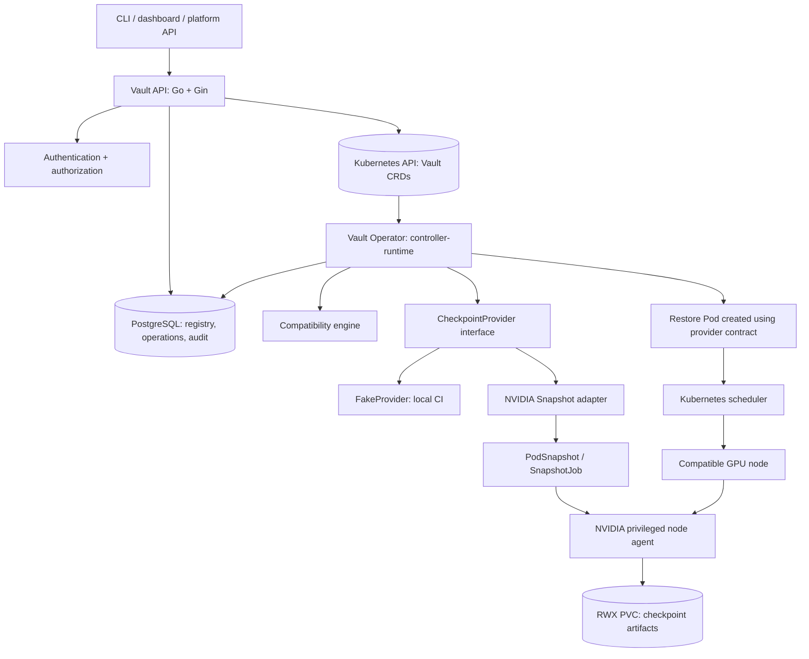

# GPU Snapshot Vault

> **Project specification + technical design + implementation plan + Cursor execution brief**  
> Version: `0.1` (proposed) · Updated: **2026-11-16** · Status: **Planning / experimental**  
> Intended audience: developer building an open-source, Kubernetes-native GPU snapshot management project.

---

## 0. Instructions to Cursor — start here

**You are the lead Go/Kubernetes engineer building an open-source project named `gpu-snapshot-vault`. Treat the rest of this document as the product and engineering specification.**

**Your goal:** Implement a working, well-tested, incremental MVP for registering, managing, and restoring initialized GPU workload snapshots via an external checkpoint provider. Use NVIDIA's open-source `ai-dynamo/snapshot` system as the first real provider; provide a fake provider for GPU-free development and CI.

**Implementation rules (mandatory):**

1. First inspect the workspace and create a short `docs/implementation-status.md` checklist. If the repository is empty, initialize it as described below.
2. Work in small, independently testable milestones. Do **not** claim functionality works until its tests run. Never fake a successful physical GPU restore.
3. First implement a fully functional **GPU-free development path** (Gin API, PostgreSQL, Kubernetes reconciler tests, fake provider, CLI/HTTP requests). The real NVIDIA integration comes after the architecture is testable.
4. For the real integration, **pin a specific NVIDIA Snapshot release or Git commit**, inspect its actual Go types / CRDs / workload and restore contracts, and record the pinned version in `docs/compatibility.md`. Do **not** guess fields or invent CRD definitions.
5. Make the NVIDIA adapter a replaceable interface. Do **not** implement custom CUDA memory serialization, CRIU checkpointing, or a privileged GPU checkpoint agent.
6. Use **ReadWriteMany (RWX) PVC** as the first real checkpoint storage backend; postpone S3 artifact export/import until the chosen upstream release is verified to support it or a safe, tested transfer adapter exists.
7. Build secure defaults: explicit namespaces, minimum Kubernetes RBAC, input validation, immutable snapshot identity, no secrets in logs, no direct artifact download from the API, and no arbitrary Pod creation without authorization.
8. Prefer maintainable Go packages, interfaces, migrations, typed errors, structured logs, health endpoints, and table-driven tests. Avoid unnecessary microservices, service mesh, Kafka, Redis, or React in Milestone 1.
9. If a critical external prerequisite (GPU, NVIDIA Snapshot operator, RWX storage) is absent, provide an actionable setup guide and tests marked **SKIPPED**, not **PASSED**.
10. When a milestone is complete, report: files added, design decisions, commands executed, test results, current limitations, and next milestone. Stop after the first milestone unless the workspace/task explicitly asks for continued implementation.

**First action:** Generate the repository skeleton, local Docker Compose, database migrations, health check, OpenAPI specification, domain models, `FakeProvider`, unit tests, Makefile, and a README that clearly distinguishes simulated versus real GPU functionality.

### Suggested initial Cursor request

```text
Read GPU_Snapshot_Vault_Project_Plan.md in full. Implement Milestone 1 only.
Create a compiling Go monorepo with a Gin API, PostgreSQL migrations,
shared domain types, a fake snapshot provider, OpenAPI, Docker Compose,
Makefile, tests, and minimal docs. Do not create or pretend to create real
GPU checkpoints. Run formatter, tests, and build. Show the exact results.
Keep the repository modular for a future controller-runtime operator and
NVIDIA Snapshot provider. Follow the document's acceptance criteria.
```

---

## 1. Product overview

### 1.1 Name and tagline

**GPU Snapshot Vault** — *A Kubernetes-native registry and lifecycle control plane for reusable GPU execution snapshots.*

### 1.2 Problem

An initialized LLM inference replica may spend considerable time loading weights, initializing CUDA, warming kernels, and preparing CUDA graphs. NVIDIA Snapshot and other checkpoint technologies can capture/restore initialized GPU processes, but platform teams still need higher-level management: how to name/version artifacts, determine compatibility, govern access, apply retention policies, trigger a restore, and measure whether restore is better than cold start.

### 1.3 Product value

A platform engineer can:

- Find an initialized `vLLM` snapshot by model revision, runtime version, and GPU family.
- Create a snapshot of a checkpoint-ready workload through a repeatable API/policy.
- Record metadata and the **opaque checkpoint reference** without moving raw GPU data through Gin.
- Determine whether a destination node is *eligible* before initiating a restore.
- Start a replacement Pod on a compatible GPU node with the provider's required restore contract.
- Track asynchronous operations, status, errors, size, origin, integrity, and audit history.
- Manage retention and eventual storage-tier choices without manually interacting with checkpoint files.

### 1.4 What this product is not

- **Not** a new `cuda-checkpoint` or CRIU implementation.
- **Not** a generic backup of all physical GPU/driver firmware state.
- **Not** live migration of an in-flight generation or user KV-cache session.
- **Not** a promise of A100 → H100 checkpoint portability.
- **Not** a replacement for Kubernetes Scheduler or NVIDIA's node agent.
- **Not** initially a full inference request gateway or GPU autoscaler.

### 1.5 Users and scenarios

1. **ML platform engineer:** pre-initialize a model once, register a snapshot, restore replicas when capacity is needed.
2. **Kubernetes infrastructure team:** enforce compatibility and snapshot retention, audit restores.
3. **Inference provider:** compare cold starts vs snapshots and optionally cache artifacts near GPU capacity (future).

### 1.6 Product differentiation

The external provider **owns checkpoint mechanics**; the Vault **owns policy, inventory, compatibility prechecks, controlled orchestration, observability, and future backend independence**. Avoid building only a UI over `kubectl get podsnapshots`—that is weak differentiation.

---

## 2. MVP boundaries and success criteria

### In scope for the first end-to-end GPU-backed MVP

- Single Kubernetes cluster; two compatible GPU nodes for the cross-node demonstration.
- NVIDIA GPU workloads; single-container vLLM checkpoint path.
- Metadata catalog in PostgreSQL with provider and Kubernetes resource references.
- Snapshot creation request, eventual status, list/detail, restore request, operation tracking, soft deletion/retention.
- Controller-runtime reconciler + NVIDIA adapter + FakeProvider.
- Snapshot compatibility checks with clear rejection reasons.
- RWX PVC checkpoint artifacts **owned by NVIDIA Snapshot**.
- Simple HTTP interface and curl examples; CLI may be added after stable API.
- Integration test showing GPU A checkpoint → storage → restore on GPU B → inference health probe.

### Deliberately out of scope for the MVP

- Automatic global autoscaling, heterogeneous GPU restores, multi-cluster replication, live request migration.
- Automatic S3 import/export or rewriting upstream checkpoint directory layout.
- Arbitrary containers, multi-node GPU collectives, unsupported MIG/vGPU configurations.
- Browser dashboard, tenant billing, advanced policy DSL, artifact chunking/deduplication.

### Measurable MVP acceptance

- Local CPU-only CI runs tests without a GPU or proprietary CUDA stack.
- HTTP API creates a **durable operation record**, returns `202 Accepted`, and exposes accurate status transitions.
- Reconciliation is idempotent under retries/restarts.
- Invalid destination GPU/driver/image conditions fail closed **before creating a restore Pod**.
- Successful real GPU test on **a compatible separate node** is recorded with configuration and logs, not simulated.
- Inference readiness and a sample prompt both pass after real restore.
- Benchmark reports full request-ready timing (not merely restore syscall time) for cold and restored starts.
- Least-privilege permissions and deletion safety are documented and tested.

---

## 3. External dependencies and real-world constraints

### NVIDIA Snapshot project

Primary upstream: <https://github.com/ai-dynamo/snapshot>

Its Kubernetes API presently documents:

- `PodSnapshot` — namespaced checkpoint request and restore binding.
- `PodSnapshotContent` — **operator-managed**, cluster-scoped physical checkpoint record. Do not create or edit it directly.
- `SnapshotJob` — launch a checkpoint-ready Pod and checkpoint it once initialized.
- `nvidia.com/restore-from` — named `PodSnapshot` annotation for a restore Pod **in the same namespace**, subject to the full restore-Pod contract.

The API group currently documented is `nvidia.com/v1alpha1`. A `PodSnapshot` references the source Pod and **exactly one container** in this version. The snapshot system uses CRIU and NVIDIA CUDA checkpointing; its node agent is privileged. Upstream explicitly says its interfaces are experimental and may change. See sources in Section 19.

### Checkpoint readiness is mandatory, not cosmetic

The workload must finish initialization, stop accepting active inference traffic, reach a checkpoint-safe/quiescent state, and satisfy the upstream workload contract. Snapshotting an arbitrary busy Pod may produce invalid or unsafe application state. For an LLM serving snapshot, avoid preserving active user requests and useful KV cache; use the pinned provider's supported post-warmup quiesce/hook procedure. **Do not automatically call `llm.sleep(level=1)` as a substitute for understanding the provider's workload contract.**

### Supported hardware is constrained

Capture and restore nodes must satisfy the upstream compatibility contract. For the prototype, require an **exact GPU product match and driver version match**, plus CPU architecture, container digest, and verified runtime requirements. Block unknown/unsupported combinations; avoid optimistic inference from just `nvidia.com/gpu=1`.

### Storage reality

The upstream README has described an S3 option, while a separately published storage guide describes the currently supported chart backend as **RWX PVC**, with S3/OCI reserved. This is a **version-specific documentation discrepancy**. Therefore:

- **MVP rule:** use RWX PVC with one pinned and tested upstream release.
- Treat S3 as **planned**, not implemented, until verified against the exact upstream version or via a dedicated artifact publisher/importer.
- The Vault stores **opaque provider artifacts and references**. Never assume the checkpoint is a single ZIP/TAR file or that it can be moved transparently between clusters.
- Upstream agents read checkpoint data directly; application Pods should not mount checkpoint storage.

### Deployment prerequisites for the GPU integration path

Verify against the pinned release, including supported GPU/driver, NVIDIA GPU Operator, CUDA compatibility, container runtime, kernel version, permissive node-agent namespace, seccomp profile, and an RWX storage class. These are not satisfied by a normal Kind cluster. The local fake-provider demo is separate.

---

## 4. System architecture



### Responsibility boundaries

| Component | Owns | Does not own |
|---|---|---|
| Gin API | auth, validation, REST contract, operation submission, reads | GPU memory copies, checkpoint format |
| Vault operator | desired-state reconciliation, retries, status, provider calls, finalizers | CUDA serialization |
| PostgreSQL | searchable catalog, audit, operation index | raw process/VRAM checkpoint contents |
| NVIDIA provider | mapping Vault intent to supported upstream CRDs and restore Pod contract | global Vault policies |
| NVIDIA Snapshot operator/agent | checkpoint/restore mechanics and provider artifact lifecycle | product registry, billing, policy |
| RWX PVC | raw checkpoint bytes available to GPU node agents | compatibility logic |
| Kubernetes Scheduler | placing requested Pods on resource-compatible nodes | checkpoint restoration |

### Sources of truth

- **Vault CRD `spec`** is desired state; **Vault CRD `status`** is authoritative for current operation state.
- NVIDIA CRD status is authoritative for provider capture/restore progress.
- PostgreSQL is a searchable projection/catalog and audit store, refreshed idempotently from reconciliation. **Never mark `READY` solely because an HTTP request was accepted.**
- Storage backend is authoritative for artifact bytes. Do not store raw checkpoint contents in PostgreSQL.

### Deployment topology

- `gvault-api`: stateless deployment with restricted Kubernetes permissions.
- `gvault-controller`: leader-elected controller-runtime deployment.
- `postgres`: external/managed in production; local Docker Compose in development.
- `nvidia-snapshot` installed separately, in its own privileged namespace.
- Snapshot checkpoint volumes mounted only by upstream node agents.

---

## 5. Repository structure

```text
gpu-snapshot-vault/
├── cmd/
│   ├── gvault-api/main.go
│   ├── gvault-controller/main.go
│   └── vaultctl/main.go                 # later milestone
├── internal/
│   ├── api/
│   │   ├── handlers/                   # Gin handlers
│   │   ├── middleware/                  # auth, request IDs, logging
│   │   ├── dto/
│   │   └── router.go
│   ├── domain/
│   │   ├── snapshot.go
│   │   ├── operation.go
│   │   ├── compatibility.go
│   │   └── errors.go
│   ├── service/
│   │   ├── snapshot_service.go
│   │   └── restore_service.go
│   ├── repository/
│   │   ├── snapshots.go
│   │   ├── operations.go
│   │   ├── audits.go
│   │   └── postgres/
│   ├── provider/
│   │   ├── provider.go
│   │   ├── fake/
│   │   └── nvidia/
│   ├── compatibility/
│   ├── controller/
│   │   ├── vaultsnapshot_controller.go
│   │   ├── vaultrestore_controller.go
│   │   └── status_sync.go
│   ├── kube/
│   ├── config/
│   ├── authz/
│   └── telemetry/
├── api/
│   └── v1alpha1/                      # OUR CRDs, not NVIDIA CRDs
│       ├── vaultsnapshot_types.go
│       └── vaultrestore_types.go
├── config/
│   ├── crd/bases/
│   ├── rbac/
│   ├── manager/
│   ├── samples/
│   └── helm/gpu-snapshot-vault/
├── db/migrations/
├── deploy/
│   └── docker-compose.yml             # API + database only; no real GPU
├── examples/
│   ├── fake-provider/
│   └── vllm-nvidia/                    # tested real-GPU instructions
├── docs/
│   ├── architecture.md
│   ├── api.md
│   ├── compatibility.md
│   ├── security.md
│   ├── gpu-setup.md
│   ├── troubleshooting.md
│   ├── benchmarks.md
│   ├── roadmap.md
│   └── implementation-status.md
├── tests/
│   ├── integration/
│   └── e2e/
├── .github/workflows/
├── .cursor/rules/                      # concise instructions; optional
├── openapi/openapi.yaml
├── Makefile
├── go.mod
├── .golangci.yml
├── .env.example
├── README.md
├── LICENSE                            # Apache-2.0
├── CONTRIBUTING.md
├── CODE_OF_CONDUCT.md
├── SECURITY.md
└── MAINTAINERS.md                     # use real maintainers only
```

Use a **single Go module** and two binaries initially. Share internal domain/providers. Do not create many deployable services before they are necessary.

---

## 6. Domain model, storage schema, and artifacts

### 6.1 Snapshot catalog entity

```json
{
  "id": "01JEXAMPLESNAPSHOTID",
  "name": "llama8b-a100-20261116",
  "namespace": "inference",
  "cluster_id": "dev-gpu-cluster",
  "status": "READY",
  "provider": "nvidia-snapshot",
  "provider_version": "PINNED_RELEASE",
  "provider_snapshot_ref": {
    "kind": "PodSnapshot",
    "namespace": "inference",
    "name": "llama8b-base",
    "uid": "UPSTREAM_UID"
  },
  "provider_content_ref": "UPSTREAM_CONTENT_NAME",
  "model": {
    "name": "llama-8b",
    "revision": "PINNED_MODEL_REVISION",
    "framework": "vllm",
    "framework_version": "PINNED_VLLM_VERSION"
  },
  "container": {
    "image_digest": "sha256:PINNED_DIGEST",
    "source_container_name": "main"
  },
  "hardware": {
    "gpu_product": "NVIDIA A100 80GB",
    "gpu_count": 1,
    "driver_version": "PINNED_DRIVER_VERSION",
    "architecture": "amd64",
    "kernel_release": "PINNED_KERNEL_RELEASE"
  },
  "artifact": {
    "backend": "pvc",
    "store_id": "UPSTREAM_OPAQUE_STORE_ID_OR_NULL",
    "handle": "UPSTREAM_OPAQUE_ARTIFACT_HANDLE_OR_NULL",
    "size_bytes": null,
    "digest": null
  },
  "created_at": "2026-11-16T00:00:00Z",
  "ready_at": null
}
```

**Values above are placeholders, not real snapshot data.** For exact GPU identity, image digests, and low-level compatibility metadata, use the provider's manifest and discovered source attributes. Never trust user-submitted values as proof of compatibility. The upstream `artifactHandle` is opaque: do **not** treat it as an S3 key or file path.

### 6.2 Minimum SQL tables

- `snapshots`: `id PK`, `name`, `cluster_id`, `namespace`, `provider`, `status`, `source_pod_uid`, `provider_snapshot_name`, `provider_snapshot_uid`, `provider_content_name`, `model_name`, `model_revision`, `framework`, `framework_version`, `image_digest`, `gpu_model`, `gpu_count`, `driver_version`, `architecture`, `kernel_version`, `artifact_backend`, `artifact_ref_jsonb`, `size_bytes nullable`, `created_at`, `ready_at`, `deleted_at`, `resource_version`. Index `(cluster_id, namespace, name)`, `(status, gpu_model)`, and provider binding.
- `operations`: `id PK`, `type` (`CAPTURE`, `RESTORE`, `DELETE`), `snapshot_id FK`, `cluster_id`, `namespace`, `status` (`PENDING`, `RUNNING`, `SUCCEEDED`, `FAILED`, `CANCELLED`), `requested_by`, `request_id`, `idempotency_key`, `target_pod_name nullable`, `error_code nullable`, `error_message nullable`, `created_at`, `updated_at`, `finished_at nullable`.
- `audit_events`: `id PK`, `actor`, `action`, `resource_type`, `resource_id`, `decision`, `request_id`, `timestamp`, `attributes_jsonb` (**sanitized**; never include raw tokens or environment secrets).
- `snapshot_tags` (optional): snapshot ID + key/value.

Create ordered SQL migrations with constraints, unique indexes, FK relationships, and rollback counterparts. Prefer standard `database/sql` and `pgx` or one well-supported query layer; avoid scattering SQL in handlers.

### 6.3 Actual artifact storage

**MVP:** Raw snapshot artifacts are stored by NVIDIA's provider agent in its RWX PVC. Vault saves Kubernetes resource references and provider-defined opaque artifact locators. Vault **does not reinterpret, upload, extract, or directly delete checkpoint bytes**.

**Future:** `ArtifactRepository` interface for provider-supported S3/MinIO and caches. Do not implement cross-cluster import/export until the provider can register an imported artifact on the target cluster with preserved compatibility information and validated integrity.

---

## 7. APIs (our product's contract; all routes are proposed)

Base path: `/api/v1`. OpenAPI 3.1 specification required. Every mutation must be authenticated and authorized outside explicit development mode. Standard errors: `code`, `message`, `details`, `requestId`.

| Method | Path | Meaning |
|---|---|---|
| `GET` | `/healthz` | Process health |
| `GET` | `/readyz` | Dependencies ready |
| `POST` | `/api/v1/snapshots` | Submit capture operation (202) |
| `GET` | `/api/v1/snapshots` | Paginated list with filters |
| `GET` | `/api/v1/snapshots/{id}` | Catalog entry and provider status |
| `DELETE` | `/api/v1/snapshots/{id}` | Submit guarded deletion (202) |
| `POST` | `/api/v1/snapshots/{id}/compatibility` | Target compatibility evaluation |
| `POST` | `/api/v1/snapshots/{id}/restore` | Submit restore operation (202) |
| `GET` | `/api/v1/operations/{id}` | Check async status |
| `GET` | `/api/v1/providers` | Installed and healthy providers |
| `GET` | `/metrics` | Prometheus metrics (protected in production) |

### Capture request

```http
POST /api/v1/snapshots
Idempotency-Key: capture-llama8b-20261116
Content-Type: application/json
```

```json
{
  "name": "llama8b-base-v1",
  "clusterId": "dev-gpu-cluster",
  "namespace": "inference",
  "source": {
    "podName": "llama-vllm-0",
    "containerName": "main"
  },
  "provider": "nvidia-snapshot",
  "labels": { "team": "inference" }
}
```

Return `202` **only after** the operation is durably persisted and its work is reliably enqueued (for instance, an outbox record or successful CRD creation with retry-safe reconciliation). Avoid API/database split-brain: use a transactional outbox or explicit compensation/reconciliation for failed Kubernetes submissions.

```json
{
  "snapshotId": "snap_01",
  "operationId": "op_01",
  "status": "PENDING"
}
```

### Compatibility request

```http
POST /api/v1/snapshots/snap_01/compatibility
Content-Type: application/json
```

```json
{ "targetClusterId": "dev-gpu-cluster", "targetNodeName": "gpu-node-b" }
```

Illustrative response:

```json
{
  "eligible": false,
  "reasons": [
    { "code": "GPU_MODEL_MISMATCH", "message": "Source and destination GPU products differ" }
  ],
  "verifiedFields": ["gpuModel", "driverVersion"],
  "unknownFields": ["cpuFeatures"]
}
```

**Important:** A Vault compatibility check is a **preflight filter**, not a guarantee of successful restoration. The provider's low-level runtime remains the final authority.

### Restore request

```http
POST /api/v1/snapshots/snap_01/restore
Idempotency-Key: restore-snap01-replica1
Content-Type: application/json
```

```json
{
  "targetClusterId": "dev-gpu-cluster",
  "namespace": "inference",
  "podName": "llama-vllm-restored-1",
  "targetNodeName": "gpu-node-b"
}
```

For MVP, require the **same cluster and namespace** as the source snapshot, unless the provider supports verified import/bind semantics. `targetNodeName` is an optional request; if set, validate node authorization and feasibility. Normal placement should use a safe, validated node selector / affinity and the Kubernetes scheduler, not bypass it by forcing `spec.nodeName` indiscriminately.

Return `202` + `operationId`; the actual restoration completes asynchronously.

### Status semantics

- Snapshot: `PENDING -> CAPTURING -> READY`; `FAILED` terminal for that attempt; `DELETING -> DELETED` via guarded cleanup.
- Restore: `PENDING -> VALIDATING -> SCHEDULING -> RESTORING -> VERIFYING -> SUCCEEDED`, or `FAILED`.
- All transitions must be idempotent and monotonic for each operation attempt. Retry creates a new attempt or resumes based on provider state; never silently overwrite a failed checkpoint as READY.

---

## 8. Kubernetes API design (our own CRDs)

Create CRDs only for Vault intent, not for reimplementing NVIDIA data structures.

### `VaultSnapshot` (proposed `vault.gpu.dev/v1alpha1`)

```yaml
apiVersion: vault.gpu.dev/v1alpha1
kind: VaultSnapshot
metadata:
  name: llama8b-base-v1
  namespace: inference
spec:
  provider: nvidia-snapshot
  source:
    podName: llama-vllm-0
    containerName: main
  retentionPolicy: Retain
```

Controller reads Pod UID and validates checkpoint readiness, then creates the **upstream** `PodSnapshot` or `SnapshotJob` using the exact pinned API. `status` carries provider references, Ready/Failed conditions, last reconciliation error, and observed generation.

### `VaultRestore` (proposed `vault.gpu.dev/v1alpha1`)

```yaml
apiVersion: vault.gpu.dev/v1alpha1
kind: VaultRestore
metadata:
  name: llama8b-restore-b
  namespace: inference
spec:
  snapshotRef: llama8b-base-v1
  target:
    podName: llama-vllm-restored-1
    nodeSelector:
      kubernetes.io/hostname: gpu-node-b
```

The operator finds the correct source workload template and invokes the provider's **restore Pod contract builder** to produce a valid target Pod. Store the pinned image digest, container identity, and required volumes/hooks; do not generate a bare Pod with only `nvidia.com/restore-from` and assume it will work. Include admission/RBAC checks restricting permitted workloads and nodes. Observe the restored Pod's provider-specific completion condition, followed by an application readiness/inference check.

### NVIDIA `PodSnapshot` reference (check exact pinned schema before use)

```yaml
apiVersion: nvidia.com/v1alpha1
kind: PodSnapshot
metadata:
  name: llama8b-upstream
  namespace: inference
spec:
  source:
    podRef:
      name: llama-vllm-0
      containers:
        - main
```

This is a **minimal illustrative upstream capture request**, not a fully configured checkpoint-ready workload. Obtain the live Pod UID and apply the exact workload contract of the pinned release. Never construct `PodSnapshotContent` yourself.

---

## 9. Core Go interfaces

Use packages under `internal/provider` and `internal/domain`. Keep methods **intent-driven**, typed, context-aware, and idempotent.

```go
package provider

import "context"

type CheckpointProvider interface {
    Name() string
    CheckPrerequisites(ctx context.Context, clusterID string) error
    RequestCapture(ctx context.Context, req CaptureRequest) (ProviderRef, error)
    CaptureStatus(ctx context.Context, ref ProviderRef) (CaptureState, error)
    EvaluateCompatibility(ctx context.Context, snapshot SnapshotInfo, target TargetInfo) CompatibilityResult
    RequestRestore(ctx context.Context, req RestoreRequest) (ProviderRef, error)
    RestoreStatus(ctx context.Context, ref ProviderRef) (RestoreState, error)
    RequestDelete(ctx context.Context, ref ProviderRef) error
}
```

The associated structs should live in shared domain packages, with stable IDs, namespace, cluster ID, caller identity, source Pod UID, provider refs, conditions, and typed error codes. Build two implementations:

- `FakeProvider`: deterministic state transitions, configurable delays/failures, no GPU dependency, works in unit/integration tests.
- `NvidiaProvider`: uses Kubernetes dynamic client or version-pinned typed clients to interact with upstream CRDs; uses the supported Go Pod contract library if available for that release. Never call privileged agent endpoints directly from Vault.

### Compatibility engine

Compare provider manifest/source metadata against the candidate node and requested Pod runtime. MVP **fail closed** if required metadata is missing. Required checks include:

- Exact GPU product and count/topology match.
- Driver version match and provider-supported CUDA/host runtime constraints.
- CPU architecture and CPU feature subset required by checkpoint.
- Container image **digest** match, required files, volumes, memory and runtime security conditions.
- Snapshot `Ready` state, artifact availability, namespace binding, version-compatible provider.
- Sufficient allocatable GPU and node resources; disallow cross-cluster by default.

Return structured mismatch codes rather than a single boolean. Preflight policy should be separately unit tested and must never substitute for the provider's final restore validation.

---

## 10. End-to-end workflows

### A. Capture initialized vLLM on GPU Node A

1. Install a supported NVIDIA Snapshot release, NVIDIA GPU Operator, and RWX volume; verify agent readiness.
2. Start a vLLM image **explicitly adapted to the upstream snapshot workload contract** (quiesce/ready hooks, control volume, seccomp and post-restore behavior as required).
3. Wait until weights, CUDA context, kernels and any planned warmup are complete. Ensure no user traffic or active generation is in progress.
4. Submit Vault `POST /snapshots` or a `VaultSnapshot` CRD. API authorizes the caller and persists a pending operation.
5. Vault operator validates source identity and coordinates creation of upstream `PodSnapshot` (or a `SnapshotJob` for a launch-and-capture workflow).
6. NVIDIA operator and node agent checkpoint CPU/GPU process state into the shared RWX PVC.
7. Vault watches upstream Ready/Failed status and records the `PodSnapshotContent` reference and immutable compatibility metadata.
8. Snapshot is marked READY only after upstream confirms the usable artifact. API/CLI displays status and age.

### B. Restore the snapshot on compatible GPU Node B

1. Client requests a restore for a READY snapshot.
2. API and controller authorize the target cluster, namespace, Pod name, model and source image.
3. Compatibility engine determines eligible GPU nodes; reject incompatible/unknown cases with reasons.
4. Operator invokes the exact pinned upstream restore-Pod contract implementation, supplying the snapshot reference and source container mapping.
5. Kubernetes schedules a compatible Pod. GPU B's NVIDIA node agent reads the snapshot artifact from RWX storage and reconstructs process/GPU state.
6. Wait for the provider's restored condition, then application health/readiness and a simple inference probe.
7. Record operation status, elapsed time, failures, node, and request correlation ID. Only route production traffic after successful health checks.

### C. Delete / retention

1. Verify the snapshot is not protected by retention/hold and has no active restores or consumers.
2. Mark deletion requested; remove/cleanup references via the provider's supported lifecycle, not arbitrary path deletion.
3. Observe upstream cleanup completion; then mark catalog DELETED (retain audit metadata as policy permits).
4. On failure, keep status DELETING/FAILED with a retriable reason and do not orphan artifacts silently.

---

## 11. Security and reliability requirements

**Checkpoint artifacts may include process memory, model information, tokens, secrets, and user data. Treat them as sensitive.**

- Authentication: explicit dev-only local bypass (off by default outside localhost). For staging/production use validated OIDC JWT and per-namespace authorization.
- Authorization: minimum `get/list/watch/create` access to Vault CRDs and selected upstream CRDs; separate controller and API service accounts; scoped Pod create permissions. Never grant generic cluster-admin.
- Validate immutable source Pod UID and container identity to avoid time-of-check/time-of-use mistakes.
- Enforce checkpoint-safe/quiescent inference window; do not snapshot ongoing user conversations by default.
- Use encryption at rest on backend PVC/S3 and encrypted transport where applicable; support KMS references later.
- Do not expose raw checkpoint downloads to browsers; no checkpoint bytes pass through Gin.
- Never put storage credentials, access keys, raw model prompts, or checkpoint memory dumps into logs or CRDs.
- Use request IDs, structured logs, Prometheus metrics, audit events, and restore result conditions.
- Add timeouts, backoff, conflict retries, leader election, and Kubernetes finalizers. Make retries and idempotency keys safe.
- Do not silently delete provider-managed content or attempt restoral from tampered artifacts.
- Explicitly document privilege requirements of NVIDIA's node agent; Vault itself should not run privileged.

---

## 12. Observability and benchmarking

Metrics to implement with stable, low-cardinality labels:

- `gvault_snapshot_operations_total{provider,outcome}`
- `gvault_capture_duration_seconds{provider}` histogram
- `gvault_restore_duration_seconds{provider}` histogram
- `gvault_restore_failures_total{reason}`
- `gvault_snapshots_ready` gauge
- `gvault_artifact_size_bytes` histogram (when known)
- `gvault_compatibility_rejections_total{reason}`

Trace/log: correlation ID from Gin → Vault CRD → upstream resource → restored Pod → readiness result.

### Benchmark protocol

Compare **same model revision, same node GPU type, same image digest, and identical readiness test**:

- `T0`: inference request triggers scale-up / launch.
- `T1`: Pod scheduled.
- `T2`: process restored or freshly initialized.
- `T3`: health and sample inference successful (request-ready).

Report: `T3-T0` (user-visible cold-start delay), restore-only time, storage read time if available, source/destination node, P50/P95 across multiple attempts, GPU time, artifact size, and failure rate. Do not publish hand-picked best-case measurements as guarantees.

---

## 13. Delivery plan (Cursor work items)

### Milestone 1 — Go foundations and fake end-to-end API

**Implement:** repository structure, `go.mod`, Gin server, config, PostgreSQL Docker Compose, SQL migrations, snapshot/operation models, repository layer, fake checkpoint provider, health endpoints, CRUD reads, capture/restore operation routes with simulated asynchronous status, OpenAPI, Makefile, unit tests, README.

**Done when:**

- `docker compose -f deploy/docker-compose.yml up -d` starts PostgreSQL.
- `make test && make build && make lint` pass (document versioned tooling).
- `GET /healthz` returns success; API persists and lists a fake snapshot; operation transitions are real application state changes, clearly marked fake.
- Bad inputs and repeated idempotency keys are tested.

### Milestone 2 — Kubernetes operator and Vault CRDs (GPU-free)

**Implement:** Kubebuilder/controller-runtime CRDs, reconciliation, conditions, finalizers, events, status-sync to PostgreSQL, fake provider integration, envtest integration tests, Helm/Kustomize manifests, RBAC.

**Done when:**

- Creating `VaultSnapshot` / `VaultRestore` drives the fake provider and reaches proper status.
- Deleting/restarting the controller or retrying events doesn't duplicate operations.
- Permission and validation errors appear in status, not as invisible failures.

### Milestone 3 — NVIDIA provider adapter and real single-node capture

**Implement:** Pin NVIDIA Snapshot upstream release, verify exact CRD schemas, add real provider, write GPU setup guide and vLLM checkpoint-ready example, capture and list real snapshot, reconcile metadata/conditions from actual resources. Put behind a feature flag until tested.

**Done when:**

- NVIDIA Snapshot operator/agent prerequisites verified on a real GPU cluster.
- Checkpoint-ready vLLM Pod successfully produces upstream Ready `PodSnapshot` and a registry entry.
- No direct hand-written checkpoint serialization or privileged commands in Vault API.

### Milestone 4 — Cross-node restore and compatibility

**Implement:** Strict compatibility engine, restore-Pod builder based on pinned contract, restore operation watcher, inference probe, structured failure reasons, test reports for GPU A → GPU B.

**Done when:**

- A real snapshot from one compatible GPU node restores on another and serves an inference prompt.
- Mismatched hardware/driver or missing compatibility facts are rejected in preflight.
- Logs and benchmark contain actual measured timings.

### Milestone 5 — Vault management differentiators

**Implement:** Immutable version/tag catalog, retention policies, deletion safety, audit trail, provider compatibility matrix, snapshot discovery filters, artifact integrity (where supported), optional CLI.

**Done when:**

- Platform engineer can discover, compare, promote/tag, restore and safely retire versions from one interface.
- Retention does not break active restores or raw upstream artifact consistency.

### Milestone 6 — After MVP / community direction

- S3/MinIO backend or export/import **after verified upstream support**.
- Node-local caching and placement optimization with measured benefits.
- Multi-cluster snapshot catalog and replication with safe provider bind/import process.
- React dashboard; advanced policies; provider adapters beyond NVIDIA.
- Inference-aware autoscaling based on observed warm/sleep/restore/cold-start costs.

---

## 14. Test matrix

| Test | Fake/local CI | Real GPU cluster |
|---|---:|---:|
| Domain validation and operation state transitions | Required | Optional |
| Gin API auth/inputs/idempotency | Required | Optional |
| PostgreSQL migrations/integration | Required | Optional |
| Reconciler status + retry + finalizer (`envtest`) | Required | Optional |
| Missing/mismatched compatibility data | Required | Required |
| NVIDIA upstream CRDs present and version pinned | No | Required |
| Real vLLM capture reaches READY | No | Required |
| GPU A snapshot restored on GPU B | No | Required |
| Inference after restore | No | Required |
| Raw checkpoint artifact cleanup via provider | Mock only | Required |
| Cold vs restored end-to-end benchmark | No | Required |

For tests that require a GPU: clearly mark prerequisites and skip reasons, and never substitute fake outputs for measured performance.

---

## 15. Developer experience and command contracts

Implement these Makefile targets:

```makefile
# Contract/targets expected from Cursor (implement actual recipes):
# make fmt
# make lint
# make test
# make test-integration
# make build
# make run-api
# make run-controller
# make generate     # CRD code generation
# make manifests    # CRD/RBAC YAML
# make install-crds
# make uninstall-crds
# make docker-up
# make docker-down
```

A local developer should be able to:

1. Clone repository, copy `.env.example` to `.env`.
2. Start Postgres via Docker Compose.
3. Run migration and API server on localhost.
4. Submit a fake snapshot and restore via HTTP.
5. Run all unit/integration tests without GPU hardware.

A real GPU operator should follow `docs/gpu-setup.md`, which **must** include the exact tested NVIDIA Snapshot version, GPU Operator, driver, container runtime, RWX PVC, workload entrypoint/hook instructions, capture and restore commands, and troubleshooting steps.

---

## 16. Example CLI and user journey (future `vaultctl`)

```bash
# Future CLI design; NOT implemented yet.
vaultctl snapshot create \
  --name llama8b-base-v1 \
  --namespace inference \
  --pod llama-vllm-0 \
  --container main

vaultctl snapshot list --namespace inference
vaultctl snapshot inspect llama8b-base-v1
vaultctl snapshot check llama8b-base-v1 --node gpu-node-b
vaultctl snapshot restore llama8b-base-v1 \
  --namespace inference \
  --pod llama-vllm-restored-1 \
  --node gpu-node-b
vaultctl operation get op_01
```

CLI API must reflect asynchronous status. Never print `restored` until the restored Pod and application probe succeed.

---

## 17. Roadmap for open-source / eventual CNCF Sandbox application

**The first project goal is working code and independent usefulness, not immediate CNCF acceptance.**

- Adopt Apache-2.0 from the beginning, confirm dependency license compatibility.
- Add `CONTRIBUTING.md`, `CODE_OF_CONDUCT.md`, `SECURITY.md`, and `MAINTAINERS.md` with truthful contributors/organizations.
- Publish public roadmap, architecture decision records, reproducible GPU benchmark results, install docs and demo video.
- Clearly document overlap and upstream cooperation with NVIDIA Snapshot; explore upstream collaboration/subproject option rather than duplicating lower-level engine internals.
- Collect independent contributions and real adopters; maintain stable APIs through versioning.
- Re-check CNCF Sandbox application rules before submitting. As of November 2026, the form specifies Apache-2.0, maintainers-file formatting, a repository with **at least six months of active development**, and a reusable product (not a reference implementation).

Potential unique longer-term research problem: selecting among warm replica, vLLM sleeping replica, checkpoint restore, or cold start subject to cost/latency SLO and measured storage bandwidth. Keep this out of the core Vault MVP.

---

## 18. Risks, unknowns and decisions to validate

| Risk/unknown | Mitigation |
|---|---|
| NVIDIA Snapshot experimental / changing APIs | Pin release; hide behind provider interface; adapter contract tests |
| S3 documentation differs by release | RWX PVC MVP; verify S3 explicitly before advertising support |
| Heterogeneous GPU incompatibility | Fail closed; exact hardware/driver policy initially |
| Snapshot contains secrets / request data | Quiesce capture; isolate/authorize; encryption and audit |
| Provider-owned checkpoint deletion semantics | Use provider lifecycle and finalizers; no direct recursive deletion |
| Shared PVC read bandwidth | Measure; later add supported cache tier if justified |
| External model files/volumes missing on restore | Persist digest/volume dependencies; provider contract validation |
| REST/DB/CRD split-brain | Idempotent operation IDs, outbox/reconciliation; CRD statuses authoritative |
| Competitive overlap with NVIDIA | Focus on registry, compatibility, retention, orchestration and multiple providers |
| No GPU hardware in local dev | Fake provider and honest GPU-only test gate |
| Commercial/CNCF adoption uncertain | Upstream collaboration, proof of measurable value and community feedback |

**Architectural decision 001:** Start with a single cluster and RWX PVC because checkpoint-restoration correctness and provider contract compatibility are more fundamental than S3 or multi-cloud replication. Revisit after the GPU A → GPU B proof works.

**Architectural decision 002:** Never duplicate checkpoint formats; store opaque references and let provider adapter interpret them.

**Architectural decision 003:** Keep inference autoscaling outside the Vault operator until the capture/restore workflow is reliable.

---

## 19. Authoritative references (verify pinned release during implementation)

1. NVIDIA Snapshot repository — <https://github.com/ai-dynamo/snapshot>
2. NVIDIA Snapshot API reference — <https://github.com/ai-dynamo/snapshot/blob/main/docs/reference/api.md>
3. NVIDIA Snapshot workload contract — <https://github.com/ai-dynamo/snapshot/blob/main/docs/reference/workload-contract.md>
4. NVIDIA Snapshot restore Pod contract — <https://github.com/ai-dynamo/snapshot/blob/main/docs/reference/restore-pod-contract.md>
5. NVIDIA Snapshot storage guide — <https://github.com/ai-dynamo/snapshot/blob/main/docs/operations/storage.md>
6. NVIDIA Snapshot security guide — <https://github.com/ai-dynamo/snapshot/blob/main/docs/operations/security.md>
7. CNCF Sandbox application checklist — <https://github.com/cncf/sandbox/blob/main/.github/ISSUE_TEMPLATE/application.yml>
8. CNCF Sandbox repository — <https://github.com/cncf/sandbox>

**Implementation note:** `main` branch documentation changes over time. Cursor should choose one tagged release/commit, verify its CRDs and Go package paths, and update this plan if pinned-version behavior differs. In particular, do not assume examples using newer `api/podcontract` library work with older releases.

---

## 20. Final definition of done

A **real** first release is complete when:

- [ ] Repository builds and tests reproducibly without GPU (fake provider).
- [ ] Authenticated API and Kubernetes operator request and track operations durably.
- [ ] PostgreSQL catalog references real upstream Kubernetes snapshots and opaque artifacts.
- [ ] Real vLLM workload meets upstream checkpoint-ready and restore lifecycle contract.
- [ ] GPU A → compatible GPU B restore passes with actual inference result.
- [ ] Incompatible restores are rejected with clear causes.
- [ ] Artifact cleanup uses provider supported lifecycle and passes safety checks.
- [ ] Documentation includes real captured timings, dependencies and failure modes.
- [ ] Apache-2.0 license, contribution docs and working install guide exist.

**Build the registry and reliable cross-node restore first. Add storage replication, UI, and intelligent autoscaling only after the end-to-end GPU path is proven.**
